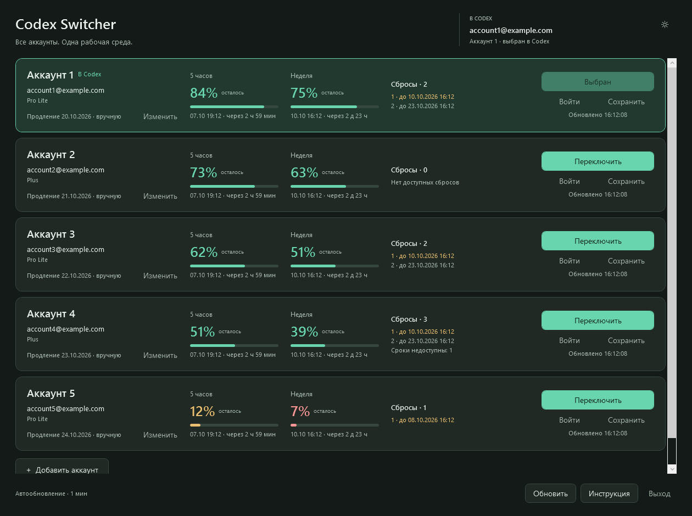

# Codex Switcher

[Русский](README.md) · **English**

**Many accounts. One workspace.** A Windows utility for switching between your saved ChatGPT accounts in the Codex desktop app, while keeping the same local Codex environment.

> Independent community project. Not affiliated with or endorsed by OpenAI. Account and workspace restrictions still apply.

## Download

Download **CodexSwitcher-1.6-win-x64.zip** from [Releases](https://github.com/kirillromanovv/CodexSwitcher/releases/latest), extract it, and run `CodexSwitcher.exe`. The executable includes its .NET runtime; no separate .NET installation is required. Builds are unsigned.

Requirements: **Windows 11 x64** and **Codex installed from Microsoft Store** (`OpenAI.Codex`). The UI currently uses Russian labels; this README documents them in English.



## Features

- Two empty account cards on first launch; add more without a fixed five-account limit.
- Remove empty cards with the trash icon. Saved or damaged credential files are protected from this operation.
- Browser sign-in and manual account switching with verification, graceful app restart and recovery after interrupted switching.
- Remaining five-hour and weekly quotas, automatically refreshed every minute, including while minimized to the tray.
- Available reset count and individual expiry dates, when provided by Codex. Unknown data remains unknown.
- Tray menu with each saved email, remaining quotas and an indicator for the active account.
- Persistent light/dark theme; sun/moon toggle in the top-right corner.
- Subscription renewal date entered manually. Codex's account protocol does not provide that billing date.

## Quick start

1. With your current account signed into Codex, click **«Сохранить»** (Save) in an empty card.
2. Click **«Войти»** (Sign in) or **«Добавить аккаунт»** (Add account) inside another card to sign in through the browser. Use the separate **«+ Добавить аккаунт»** button below the list to create another card.
3. Finish active Codex tasks, click **«Переключить»** (Switch), and confirm the restart.
4. Close the switcher window to hide it in the tray. Double-click the tray icon to reopen it. Choose **«Выход»** (Exit) to quit completely.

Sign-in for an already saved card must match that card's account and workspace. To replace a saved card with your current account, use Save and confirm the replacement. Adding an account does not immediately switch the running Codex app.

On upgrades, exit the old switcher before launching the new executable. Saved profiles are reused. All displayed times use the Windows local time zone.

## Data and security

Saved credentials and the recovery journal are encrypted using **Windows DPAPI CurrentUser** in `%LOCALAPPDATA%\Codex Switcher`. Folder access is restricted to the current Windows user and SYSTEM. Preferences are stored there in `accounts.json` and `theme.txt`.

The running Codex app keeps its normal `auth.json` format. Only this active authentication file is replaced during switching. The switcher does not delete `.codex`, projects, skills, or local chat history. Cloud content and permissions depend on the signed-in account; the shared local environment does not transfer cloud ownership or permissions.

DPAPI does not protect against software running as your Windows user. Isolated sign-in and quota queries use private temporary folders, which may retain a credential file after a process crash. Do not share the switcher's data folder or your Codex authentication files. The app does not log token contents or raw server errors.

The switcher uses the installed official `codex.exe app-server` for account verification and quota reads. It does not request an API key, issue generation requests, redeem resets, buy credits, or automatically choose an account. See [SECURITY.md](SECURITY.md) for reporting and limitations.

## Compatibility and limitations

Supports managed ChatGPT file authentication. API-key authentication, external tokens, keyring/auto or ephemeral credential storage, custom auth endpoints, and complex profile-specific auth configuration are rejected without changing those settings.

Shutdown uses Windows Restart Manager without the force flag. If Codex refuses to close, switching stops. Other active Codex CLI/extension sessions can also block switching. Finish work before switching accounts.

Local acceptance used Store package `26.930.7945.0` and CLI `0.160.1`. Compatibility with later app-server versions is not guaranteed. UI and protocol tests passed; automatic shutdown of a real active Codex app was deliberately not exercised during development. Earlier switching behavior was confirmed by the owner.

## Build and verify

Requires .NET SDK 10.x. No third-party application libraries are used.

```powershell
./scripts/verify.ps1 -Preview
./scripts/build.ps1
```

The verifier runs **45 synthetic checks**, builds WPF, and renders light/dark, tray and recovery previews. It also checks live theme changes and adding/removing an empty card using synthetic data. With a locally installed Store Codex, optional `-ProtocolSmoke` verifies the protocol in an isolated signed-out folder. CI uses the synthetic checks, not real accounts.

Builds target self-contained `win-x64`. Downloadable archives contain the EXE and documentation; source code lives in `src/`, with tests in `tests/`. Release checksums are published with each release.

## Contributing and license

See [CONTRIBUTING.md](CONTRIBUTING.md), [CHANGELOG.md](CHANGELOG.md), and the [MIT license](LICENSE). Never include authentication files, tokens, real emails, logs or local state in an issue or pull request.

Protocol references: [Codex app-server](https://learn.chatgpt.com/docs/app-server), [authentication](https://learn.chatgpt.com/docs/auth), [Windows DPAPI](https://learn.microsoft.com/en-us/windows/win32/api/dpapi/nf-dpapi-cryptprotectdata).
